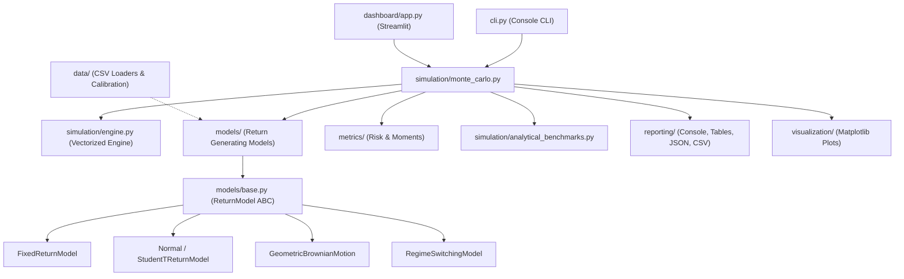

# Architecture Documentation: Quant Finance Lab

Quant Finance Lab is designed as a modular, extensible, and high-performance quantitative research package.

---

## 1. Package Architecture Overview



---

## 2. Layer Responsibilities

### 2.1 Core Layer (`quant_finance_lab.core`)
* `config.py`: Strictly validated configuration dataclasses (`SimulationConfig`, `RiskThresholds`).
* `validation.py`: Input assertions (probabilities $\in [0, 1]$, finite bounds, positive balances).
* `random_state.py`: Explicit, thread-safe NumPy `Generator` and `SeedSequence` management.
* `exceptions.py`: Domain exception hierarchy (`ValidationError`, `SimulationError`, `ModelError`, `DataError`).

### 2.2 Models Layer (`quant_finance_lab.models`)
* `base.py`: Abstract base class `ReturnModel` specifying the return generation contract `generate_returns()` and analytical expectation methods.
* `fixed_return.py`: The original Bernoulli binary trading model with analytical expectation $\mathbb{E}[B_N]$ and variance formulas.
* `variable_return.py`: Gaussian and fat-tailed Student-t continuous return distributions.
* `stochastic_processes.py`: Geometric Brownian Motion with exact discrete log transitions.
* `market_regimes.py`: Two-state Markov regime-switching model.
* `costs.py`: Configurable trading frictions (fixed fees, basis point spreads/commissions).
* `position_sizing.py`: Full compounding, fixed-fractional, and Kelly Criterion allocation rules.

### 2.3 Simulation Layer (`quant_finance_lab.simulation`)
* `engine.py`: Vectorized execution across simulations and trade horizons, supporting chunked memory execution.
* `monte_carlo.py`: High-level simulation orchestrator producing `SimulationResult`.
* `analytical_benchmarks.py`: Theoretical expectation calculators and Monte Carlo z-score validation.

### 2.4 Metrics Layer (`quant_finance_lab.metrics`)
* `confidence.py`: Wilson score confidence interval and Student's t confidence interval.
* `drawdown.py`: Peak-to-trough series, maximum drawdown distribution, exceedance probabilities.
* `risk.py`: First-passage path ruin, terminal ruin, Value at Risk (VaR), and Expected Shortfall (CVaR).
* `returns.py`: Absolute returns, CAGR, geometric growth rate, Sharpe/Sortino ratios.
* `distributions.py`: Higher moments (variance, skewness, excess kurtosis) and financial target analysis.

### 2.5 Visualization & Reporting Layers
* `visualization/`: Publication-grade Matplotlib plots configured with headless `'Agg'` backend.
* `reporting/`: Structured console reports, formatted ASCII tables, JSON metadata, and CSV export.

---

## 3. Extending the Library

Adding a new stochastic model requires only subclassing `ReturnModel` in `src/quant_finance_lab/models/`:

```python
from quant_finance_lab.models.base import ReturnModel
import numpy as np

class CustomModel(ReturnModel):
    @property
    def name(self) -> str:
        return "My Custom Stochastic Model"
        
    @property
    def assumptions(self) -> list[str]:
        return ["Custom return dynamics."]
        
    def generate_returns(self, num_simulations: int, num_trades: int, rng: np.random.Generator) -> np.ndarray:
        # Return 2D array of return rates with shape (num_simulations, num_trades)
        return rng.uniform(-0.02, 0.03, size=(num_simulations, num_trades))
        
    def to_dict(self) -> dict:
        return {"model_type": "CustomModel"}
```
All metrics, drawdowns, visualizers, sensitivity sweeps, and CLI commands automatically work with any new model.
