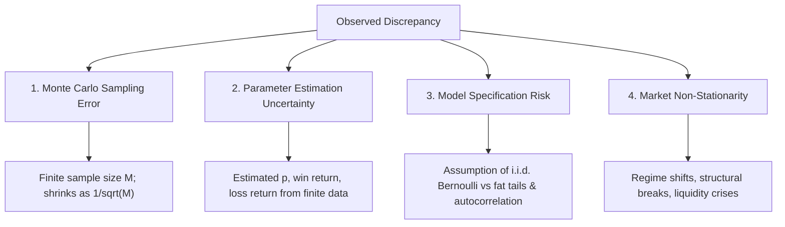

# Statistical Methods and Uncertainty in Simulation

Quant Finance Lab explicitly distinguishes between different sources of uncertainty rather than presenting simulation percentages as absolute real-world truths.

---

## 1. Taxonomy of Uncertainties

In financial simulation and quantitative modelling, four distinct sources of uncertainty exist:

1. **Monte Carlo Sampling Uncertainty**:
   The error introduced strictly by evaluating $M$ random paths rather than an infinite ensemble. This is quantifiable, bounded by statistical confidence intervals, and decays at the rate $O(1/\sqrt{M})$.
2. **Parameter Estimation Uncertainty**:
   Even if the true market followed an i.i.d. Bernoulli process, estimating $p = 0.60$ from 100 historical trades has a standard error of $\sqrt{0.6 \times 0.4 / 100} \approx 0.049$. A true $p$ of 0.55 versus 0.60 creates a drastic difference in compounded wealth.
3. **Model Specification Risk**:
   Assuming i.i.d. trade returns ignores volatility clustering (ARCH/GARCH), regime switching, serial correlation in trade outcomes, and liquidity gaps.
4. **Market Non-Stationarity & Regime Risk**:
   Financial markets evolve over time. Past parameters may reflect a specific market regime that does not persist into the future.

---

## 2. Confidence Intervals for Monte Carlo Estimates

### 2.1 Binomial Event Probabilities (Target & Ruin)
For event indicators (e.g. $B_N \ge T$ or $B_t \le R_{\text{ruin}}$), we use the **Wilson Score Interval** rather than the asymptotic Wald interval:
* Wald interval: $\hat{p} \pm z_{\alpha/2} \sqrt{\frac{\hat{p}(1-\hat{p})}{M}}$
  * Flaw: If $\hat{p} = 0$, Wald gives $[0, 0]$, creating a false illusion of mathematical impossibility.
  * Flaw: Can produce limits $< 0$ or $> 1$.
* Wilson interval:
  * Non-zero width even when $\hat{p} = 0$ or $\hat{p} = 1$.
  * Guaranteed to remain strictly within $[0, 1]$.
  * Maintains nominal $(1-\alpha)$ coverage probability across all sample sizes $M$.

### 2.2 Expected Balance Confidence Intervals
For the continuous expected final balance $\mathbb{E}[B_N]$, we apply Student's t distribution:
$$\text{SE}(\bar{B}_N) = \frac{s_{B_N}}{\sqrt{M}}$$
$$\text{CI}_{1-\alpha} = \left[ \bar{B}_N - t_{1-\alpha/2, M-1} \frac{s}{\sqrt{M}}, \quad \bar{B}_N + t_{1-\alpha/2, M-1} \frac{s}{\sqrt{M}} \right]$$

---

## 3. Common Random Numbers (CRN) for Sensitivity Sweeps

When evaluating parameter sensitivity (e.g., comparing win probabilities $p_1$ and $p_2$), independent simulations introduce uncorrelated random noise:
$$\text{Var}(\hat{\Delta}) = \text{Var}(\hat{\mu}_1 - \hat{\mu}_2) = \text{Var}(\hat{\mu}_1) + \text{Var}(\hat{\mu}_2) - 2 \text{Cov}(\hat{\mu}_1, \hat{\mu}_2)$$

Under independent streams, $\text{Cov}(\hat{\mu}_1, \hat{\mu}_2) = 0$.
By applying **Common Random Numbers (CRN)**, both parameter sets are driven by identical pseudo-random number sequences ($U_{i,t}$), creating strong positive correlation:
$$\text{Cov}(\hat{\mu}_1, \hat{\mu}_2) > 0 \implies \text{Var}(\hat{\Delta}) \ll \text{Var}(\hat{\mu}_1) + \text{Var}(\hat{\mu}_2)$$
This significantly reduces sampling variance, isolating the pure sensitivity of the financial parameter from Monte Carlo noise.
